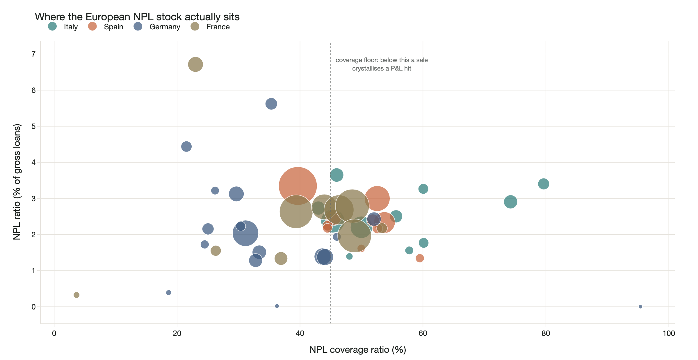
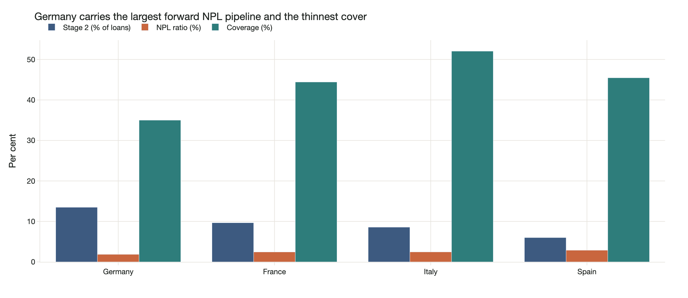

# European NPL Disposal Pipeline Monitor

[Editable project brief](docs/project-brief.md)

**Which European banks are most likely to bring loan portfolios to market in the next twelve months — and why.**

A screen over 48 significant banks in Italy, Spain, Germany and France, built from
bank-level supervisory data, with an LLM layer that reads what management has
actually said about disposals.



*Each bubble is a bank, sized by absolute NPL stock. The uncomfortable corner is
upper-left: a large non-performing book that has not been provisioned for. Banks
right of the dotted line can sell near carrying value; banks left of it take a
P&L hit to transact, which is why they wait.*

**[One-page summary (PDF)](docs/project-brief.pdf)** · Interactive dashboard
with per-bank drill-down: **[`docs/dashboard.html`](docs/dashboard.html)**

---

## Why this exists

Origination is a sourcing problem before it is an analysis problem. By the time a
portfolio is in market the price is already being competed. The useful question is
which banks are being pushed toward a sale *before* they run a process.

That question has two halves, and most screens only answer the first:

| | what it measures | where it lives |
|---|---|---|
| **Pressure** | what the balance sheet forces management to confront | regulatory data |
| **Intent** | what management has said it will do | disclosure prose |

Pressure is computable. Intent is not — it sits in annual reports, strategic plans
and results commentary, in five languages, and nobody reads it across fifty banks
by hand. That gap is the reason this repository has an AI layer rather than a
spreadsheet.

---

## The finding



**The European NPL opportunity has rotated, and the conventional geography is stale.**

Stage 2 loans are performing today but have seen a significant increase in credit
risk — they are the population from which next year's NPLs are drawn. Most screens
ignore them entirely because they sit outside the NPL ratio.

| system | NPL ratio | **Stage 2** | coverage | NPL stock |
|---|---|---|---|---|
| **Germany** | 1.9% | **13.5%** | **35.0%** | EUR 46bn |
| France | 2.4% | 9.7% | 44.4% | EUR 123bn |
| Italy | 2.5% | 8.6% | **52.0%** | EUR 38bn |
| Spain | 2.9% | 6.0% | 45.5% | EUR 70bn |

Germany has the *cleanest* headline NPL ratio, the *largest* forward pipeline and
the *thinnest* provisioning of the four systems. Italy — the market most associated
with NPL supply — is now the best reserved.

This does not say Italy is uninteresting. It says the two markets are in different
states and call for different behaviour: Italian banks are **transaction-ready**
and will sell near carrying value, so the edge is price discipline. German banks
are **accumulating a problem they have not yet reserved against**, so the edge is
being in the relationship before the process starts.

The three highest-pressure names in the screen are German, and two of them are
commercial real estate lenders.

---

## How it works

**1 · Pressure score** — four percentile-ranked factors over reported data:

- NPL ratio — how bad the book is relative to its own size
- Unreserved NPLs ÷ CET1 — the loss still to take against the buffer absorbing it
- Stage 2 share — forward NPL formation
- Absolute NPL stock (log) — is it investable at fund scale

Weights live in [`src/config.py`](src/config.py) and are exposed deliberately. The
score is a relative league table, not an absolute distress measure, and it is meant
to be disagreed with.

**Coverage is deliberately excluded from pressure.** Low coverage is usually read as
distress, but it cuts both ways: a weakly provisioned bank faces *more* supervisory
pressure to act, yet crystallises a *larger* P&L hit on sale, so it moves slower. A
well-provisioned bank can transact near carrying value — it is readier, not more
desperate. Conflating the two is the most common error in screens like this, so
coverage is reported separately as transaction readiness.

**2 · Intent extraction** — DeepSeek (`deepseek-chat`, `temperature=0`) classifies
disclosure text onto a fixed ladder (`programme` → `target` → `exploring` →
`monitoring` → `denial`), discounted by a horizon multiplier so a 2030 target is not
treated as an origination signal.

**3 · The cross** — pressure × intent gives the action:

| | intent stated | intent absent |
|---|---|---|
| **high pressure** | **Act now** — engage directly | **Watch** — constraint persists, expect a process without a public signal |
| **low pressure** | **Opportunistic** — will sell, price-sensitive | **Deprioritise** |

---

## The AI layer, and why you can trust its output

The first question any credit professional asks about LLM output is *how do you know
it didn't make that up.* Three design rules answer it:

1. **Every signal carries its source sentence and a URL.** An extracted score with no
   quote behind it is not usable in a credit process.
2. **The model never sees or produces a number.** It classifies text into a fixed
   schema; all arithmetic happens in Python afterwards.
3. **Quotes are verified character-for-character against the source.** If the model
   returns evidence that does not appear in the input text, the evidence is dropped
   and the signal is flagged — see `_llm_extract` in [`src/intent.py`](src/intent.py).

The pipeline also degrades to a deterministic keyword scorer with no API key, so the
notebooks run for anyone who clones the repository.

### What verification actually means here

A quote earns `VERIFIED_VERBATIM` by being **located in the PDF it claims to come
from**, by `scripts/promote_candidates.py`. Not by someone asserting they checked it.
That makes verification reproducible — anyone can re-run it against the same cached
document and get the same answer.

The check was tested adversarially before being trusted:

| input | result |
|---|---|
| untouched harvested quote | **pass** — located on stated page |
| plausible sentence never in the document | **reject** |
| real quote, one word silently altered | **reject** |
| real quote, wrong page claimed | **pass**, page corrected |

The third row is the one that matters. A model that subtly rewords a quote while
keeping it believable is the realistic failure mode, and the gate catches it.

### Why this works: two banks, same pressure, different call

UniCredit and BBVA both score **67** on pressure — statistically indistinguishable
on reported data. The disclosure layer separates them:

- **UniCredit → Act now.** Classified `programme`. Its Annual Report states the NPE
  Strategy *"defines... quantitative time-bound targets by time-horizon and dynamics
  (write-off, recoveries, **disposals**, flows etc.)"* — p.544, located in source.
- **BBVA → Watch.** Classified `none`. Its verified passage discusses NPL ratios
  moving, which is commentary, not intent. The model correctly declined to score it.

That second case is the better evidence. The pipeline found a passage, confirmed it
was genuinely from the document, and the classifier still returned nothing — because
there was nothing there. A screen that only ever finds signal is not a screen.

### Current coverage — read before using the output

**4 of 48 banks carry a verified quote** (13 passages). The remaining 44 are ranked on reported
regulatory data alone and are shown as **intent unconfirmed** — never as silent.
Absence of data is not evidence of absence, and the quadrant chart plots them on a
separate "not yet read" band rather than at zero.

Coverage is limited by document access, not by the method: most target banks render
their IR document lists in JavaScript, so a plain HTTP fetch sees an empty shell.
Discovery therefore runs through a real browser and the resolved PDF URLs are stored
in `data/raw/ir_sources.json`; downloading them needs no browser at all.

To extend: `scripts/harvest_disclosures.py` → review candidates →
`scripts/promote_candidates.py --apply` → re-run.

---

## Repository

Each folder has its own README covering that component in depth.

| folder | what it holds | read it for |
|---|---|---|
| **[`src/`](src/)** | the seven pipeline modules | why `harvest` and `intent` are separate, and the two EBA parsing traps |
| **[`notebooks/`](notebooks/)** | the worked analysis, 01→04 | the argument, in order, with outputs saved |
| **[`scripts/`](scripts/)** | five CLI tools | the find → verify → promote workflow, and how to add a bank |
| **[`data/`](data/)** | inputs and derived output | the provenance contract the corpus enforces |
| **[`docs/`](docs/)** | one-pager, dashboard, figures | how each artefact is regenerated |

```
european-npl-monitor/
├── notebooks/     01 universe · 02 pressure · 03 intent · 04 ranking + dashboard
├── src/           config · eba_data · pressure · harvest · intent · ranking · viz
├── scripts/       fetch_data · harvest_disclosures · promote_candidates · make_notebooks · build_onepager
├── data/          raw/ EBA source + disclosure corpus · processed/ outputs
└── docs/          one-pager.pdf · dashboard.html · figures/
```

The split between `harvest` and `intent` is deliberate. Harvesting finds candidate
passages; verification proves they are real; classification judges what they mean.
Keeping those three separate is what lets the middle step be trusted — if finding
and judging were the same component, nothing would be checking it.

## Running it

```bash
python -m venv .venv && source .venv/bin/activate
pip install -r requirements.txt
python scripts/fetch_data.py        # downloads the EBA exercise (~130 MB)
python scripts/harvest_disclosures.py   # optional: pull candidate disclosure passages
jupyter lab notebooks/
```

`DEEPSEEK_API_KEY` is optional — without it the intent layer uses its deterministic
fallback and everything else runs unchanged. The extraction client targets DeepSeek
through its OpenAI-compatible endpoint.

## Data

| source | used for | access |
|---|---|---|
| [EBA EU-wide Transparency Exercise 2025](https://www.eba.europa.eu/risk-and-data-analysis/risk-analysis/eu-wide-transparency-exercise) | bank-level NPL, Stage 2, impairment, collateral, CET1, RWA | free, public |
| Bank annual reports / Pillar 3 / results commentary | disposal intent | free, public |

Reporting period **2025-Q2**. Aggregates were checked against published EBA figures
before anything was built on them: weighted NPL ratio 2.41%, Stage 2 share 9.0%.

## Limits

- **UK is out of scope.** UK institutions left the EBA sample after Brexit, so one
  leg of the mandate is not addressable from this source. Stated, not hidden.
- **The intent layer is not yet live.** See above.
- **The CET1 requirement is a proxy.** Banks disclose institution-specific SREP
  requirements; a single 10.5% floor is used as a transparent approximation.
- **Percentile scoring is relative.** If every bank in the universe is comfortable,
  one of them still ranks first.

---

Built by Hrush Ambekar · [ambekar2709@gmail.com](mailto:ambekar2709@gmail.com)
