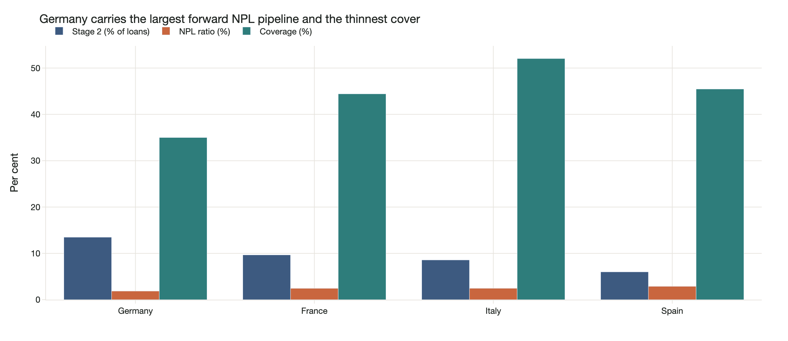

# European NPL Disposal Monitor

*Regulatory screen plus partially verified disclosure corpus · Prepared 5 November 2026*

## The research question

Which banks face pressure to sell loan portfolios, and which have actually stated disposal intent?

## Approach

Four percentile-ranked balance-sheet factors measure pressure across 48 banks. Coverage is shown separately as transaction readiness. Disclosure harvesting, verbatim PDF verification and classification are separated before pressure and intent are crossed into a sourcing view.

## Evidence and result

The dated 2025-Q2 screen highlights Germany’s Stage 2 share of 13.5% alongside 35% NPL coverage. Only 4 of 48 banks have verified quotes, across 13 passages. The verification gate rejects altered or fabricated passages; unread banks remain intent-unconfirmed.

*EBA 2025-Q2 reporting snapshot; four-country screen.*

## Scope and limitations

This is relative ranking, not a calibrated sale probability. Verified intent coverage is narrow; the UK is absent. Country averages do not identify a bank’s future sale. A verified quotation proves location, not the investment interpretation or completeness of search.

## Explore the project

Open docs/dashboard.html and docs/one-pager.html. Inspect the verified corpus and promotion script; EBA download is large and the model key is optional.

## Sources and evidence

[docs/one-pager.html](../docs/one-pager.html) · [docs/README.md](../docs/README.md) · [src/ranking.py](../src/ranking.py)

---

Hrush Ambekar · Research snapshot reviewed 5 November 2026. See linked source files for full methodology, figures and reproducibility.
